# rex for Android

[rex](https://github.com/debridmediamanager/rex) turns a phone, tablet, Android TV, Google TV or Fire TV into a media server for the Plex
apps. The Plex apps on your devices find it like any Plex server and play from it. What it
plays comes from addons; the app starts with the Internet Archive's public domain films.

[Download it from Releases](https://github.com/debridmediamanager/rex-android/releases/latest). Android 8.0 or newer. One APK fits phones and TVs; pick the one for your device's processor:
`arm64-v8a` for most phones and TV boxes, `armeabi-v7a` for older or cheaper 32-bit boxes
(Fire TV Sticks among them), `x86_64` for emulators. Google Play picks for you.

<p>
  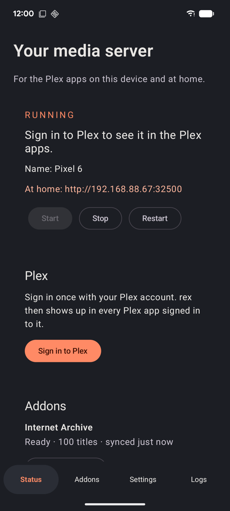
  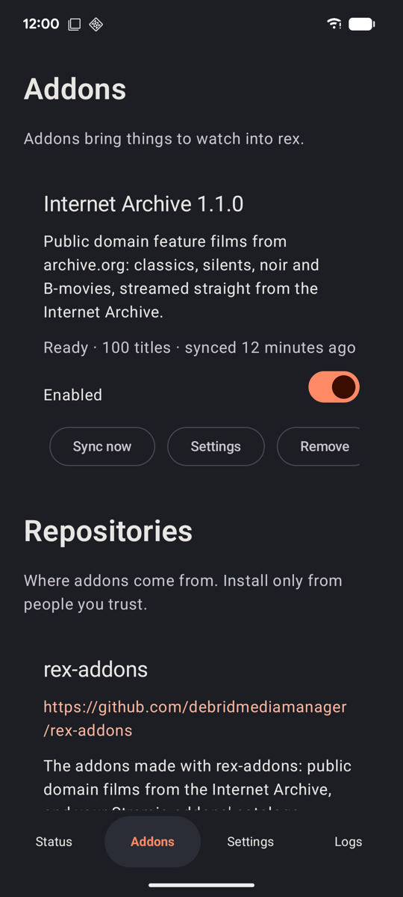
  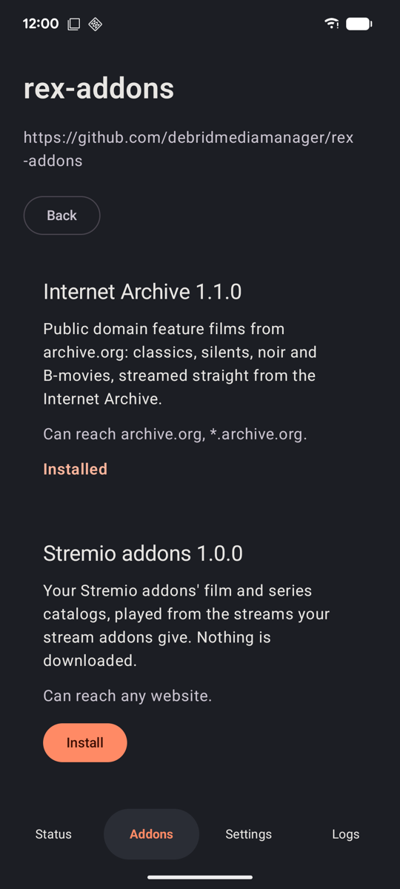
</p>
<p>
  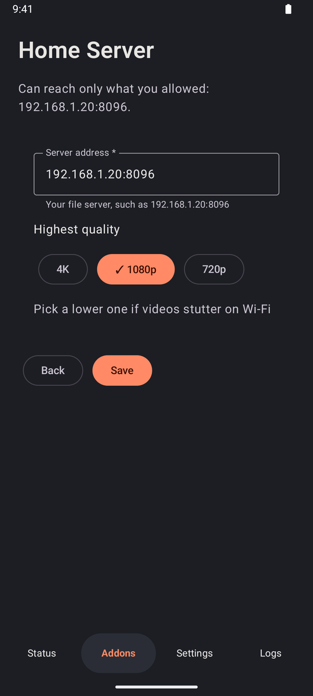
  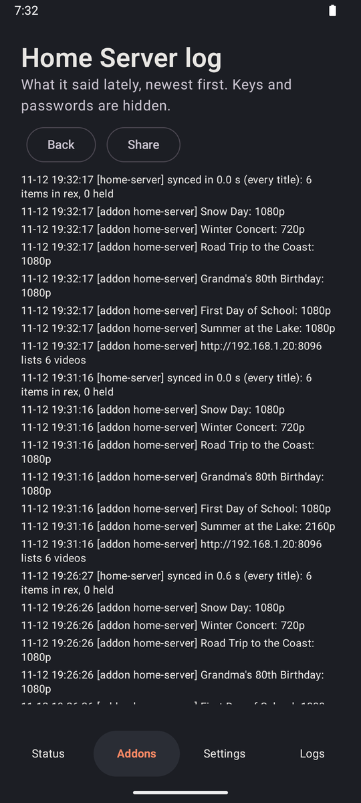
  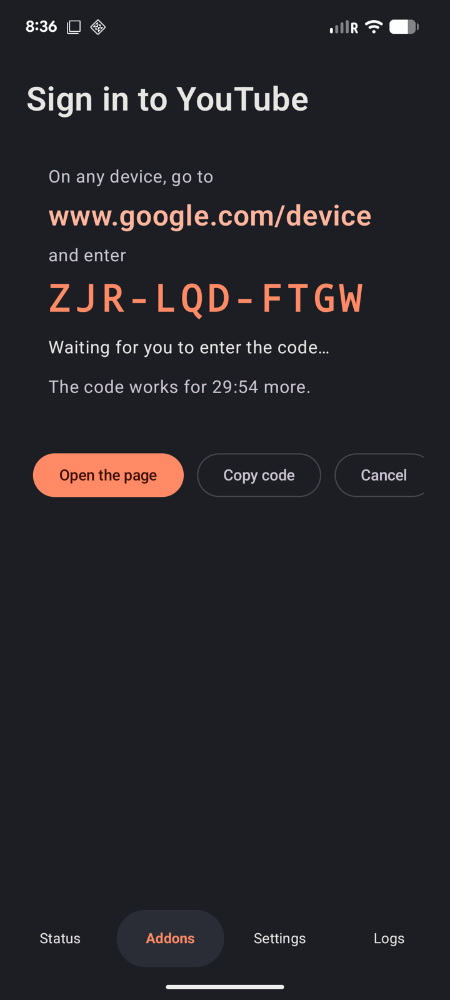
</p>
<p>
  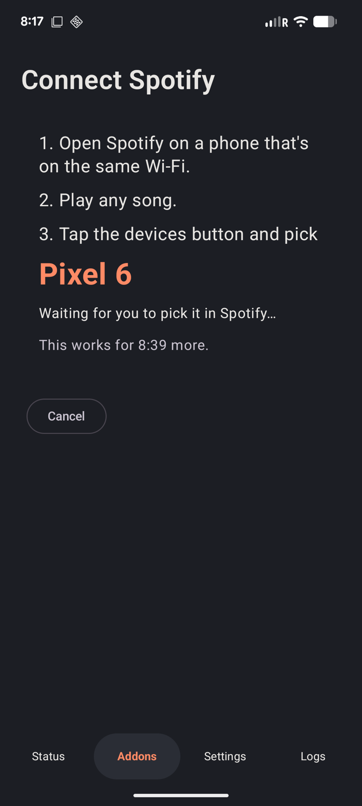
  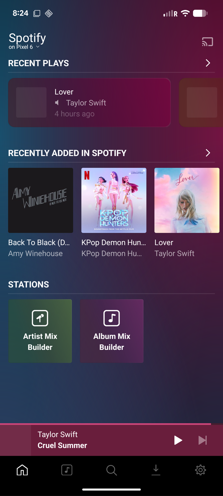
  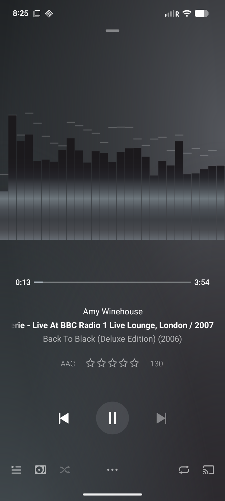
</p>
<p>
  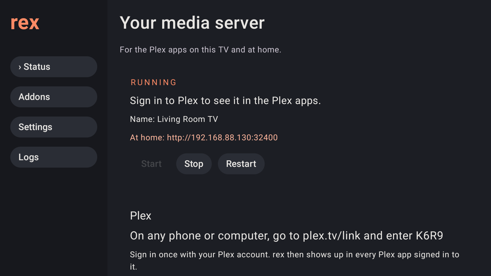
  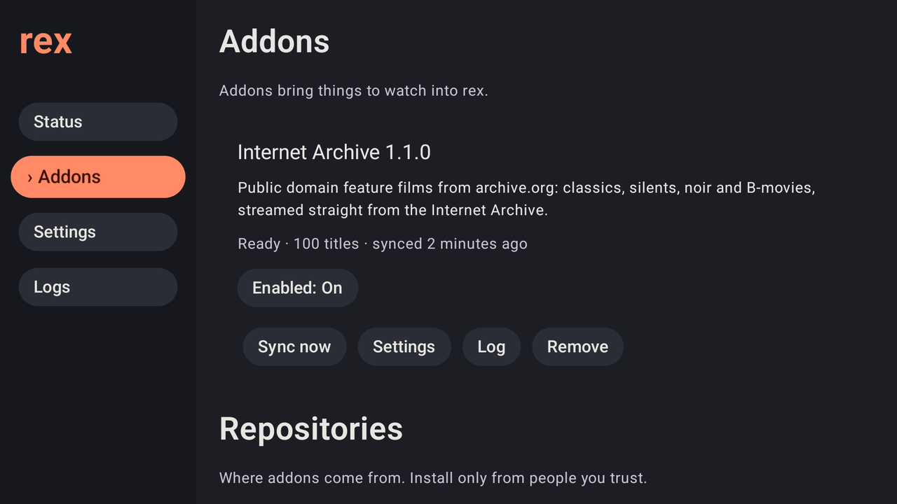
</p>
<p>
  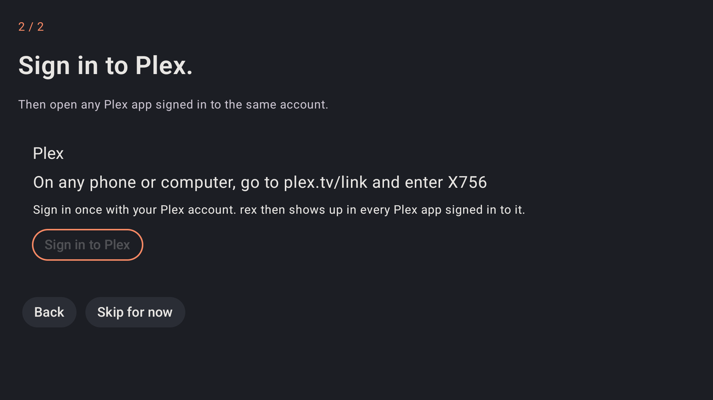
  
</p>

## Want your debrid accounts and Usenet too?

There is another version of this app with [zurg](https://zurg.debridmediamanager.com/) built in. It puts your debrid accounts and Usenet in the same server and runs the same addons. It comes with a sponsorship: [become a sponsor](https://gatekeeper.debridmediamanager.com), then [get the app](https://zurg.debridmediamanager.com/android.html).

## Set up

1. Open rex, give it a name and press **Start rex**. If another Plex server already runs on
   this device, rex says its port is taken: use `32500`.
2. **Sign in to Plex.** On a phone your browser opens; on a TV, enter the code shown at
   plex.tv/link. A free Plex account is enough. You can skip this and sign in later from Status.
3. Open any Plex app signed in to the same account and pick the server by its name.

rex keeps running in the background with a notification you can stop it from. **Settings**
can start it when the device turns on. Let it run in the background (Android's battery
settings), or some devices stop it when the screen is off; [Don't kill my app](https://dontkillmyapp.com/)
explains what else your device needs.

## Addons

**Addons** lists what each addon added, when it last synced and any problem. Turn one off,
sync it now, change its settings, read its log, update it or remove it. Entries a sync had to
leave out show as "2 left out"; its log says why. An addon that needs an account on its website shows
**Sign in**: go to the page it names and enter the code on screen (on a TV, scan the QR code with
your phone). rex notices once you did. A Spotify addon shows **Connect Spotify** instead: open
Spotify on a phone on the same Wi-Fi, play any song, tap the devices button and pick this device by
its rex name. Pairing needs the device on Wi-Fi or Ethernet; while it waits, the app keeps Wi-Fi
passing the local announcements Spotify finds it by. An addon that works through another one says
what that one needs, such as "Sign in to the YouTube addon first", and doesn't sync until then.
An addon for a server of your own (a NAS, a media server) asks for its address in
**Settings**, such as `192.168.1.20:8096`, and can then reach it, on that port only. An update that can
reach other websites, asks for another address, or comes from another repository, asks you first. Titles you delete in a Plex app stay gone;
the addon's **Settings** can bring them back.

Addons come from **repositories**: git repositories that hold addons. Add one by its link
(`github.com/user/repo` is enough), open it, and install what it offers; rex shows which
websites an addon can reach before you install it. Refresh a repository to get its updates;
removing one keeps the addons you installed from it, without further updates. Addons run sealed
off from your device and reach only the sites they name and the addresses you type; still, install only from people you
trust. How to write one: [rex-addons](https://github.com/debridmediamanager/rex-addons).

The GitHub release starts with rex-addons' own repository added. The Play Store build starts
with no repository and only the bundled Internet Archive addon.

**Logs** shows what rex and the addons said lately, with tokens, keys and passwords hidden.

## Getting help

Ask in the support thread on Discord. If we ask for logs, open **Logs** and press **Send logs
to support**. You see everything that would go before anything is sent: a few facts about the
device and rex, what your addons are doing, and the logs of this run and the one before. Keys,
tokens, passwords and the end of your public IP address are hidden. Press **Send** and you get a
code; post it in your thread. Only the support team can read what you sent, and it's deleted
after 7 days.

## What the app sends where

plex.tv for the sign-in and as any Plex server reports itself; once signed in, rex-direct on
debridmediamanager.com, which gives rex an HTTPS address for the Plex apps away from home; and
each addon's own sites; and logs.debridmediamanager.com, only when you press Send under Send logs
to support. Nothing else. See [the privacy policy](play/privacy-policy.md).

## Build

JDK 17, Android SDK 36, NDK `28.2.13676358`, Rust with the three Android targets, Python 3.10+,
make, Perl, pkg-config and nasm.

```sh
export ANDROID_HOME=~/Library/Android/sdk
./build-natives.sh        # rex and the addon host at the commits in rex.ref and rex-addons.ref
python3 build-ffmpeg.py   # ffmpeg and ffprobe, and the native source ZIP in artifacts/
./gradlew :app:testGithubDebugUnitTest :app:lintGithubDebug :app:assembleGithubDebug
```

On macOS, run `build-ffmpeg.py` with `SDKROOT` set to a Command Line Tools SDK that links,
such as `/Library/Developer/CommandLineTools/SDKs/MacOSX26.5.sdk`. Build trees live in
`~/.cache/rex-android-native` (`REX_ANDROID_NATIVE_CACHE`); `REX_ANDROID_ABIS` narrows the ABIs.

Two flavors: `github` (the APKs on GitHub, with rex-addons' repository as a default) and
`play` (the AAB for the Play Store, with none). The four programs ship as `lib<name>.so` in `jniLibs` and run from the app's native library
folder: Android executes nothing from an app's own storage. Legacy packaging keeps
`extractNativeLibs` on, so the installer puts them there, for the APKs and for the splits Play
builds from the AAB alike. Licenses and sources: [NATIVE-LICENSES.md](NATIVE-LICENSES.md).

**Release.** Sign with the upload key through `REX_ANDROID_KEYSTORE`,
`REX_ANDROID_KEYSTORE_PASSWORD`, `REX_ANDROID_KEY_PASSWORD` and `REX_ANDROID_KEY_ALIAS`
(default `upload`), set `REX_ANDROID_VERSION` and `REX_ANDROID_VERSION_CODE`, then run
`./gradlew :app:lintGithubRelease :app:lintPlayRelease :app:assembleGithubRelease :app:bundlePlayRelease`
and `./verify-release.sh`, which checks the signatures, the programs and the licenses and copies
the GitHub APKs and the Play AAB into `artifacts/`. Pushing a `vX.Y.Z` tag does all of that on GitHub and attaches the results and the
native sources to a draft release. Play Store material is in [play/](play/).

## Device tests

```sh
./gradlew :app:assembleGithubDebug :app:assembleGithubDebugAndroidTest
adb install -r app/build/outputs/apk/github/debug/app-github-<abi>-debug.apk
adb install -r app/build/outputs/apk/androidTest/github/debug/app-github-debug-androidTest.apk
adb shell am instrument -w com.debridmediamanager.rex.test/androidx.test.runner.AndroidJUnitRunner
```

They start each program from the installed app, check that rex answers on a free port with the
app's environment, and encode on the device's MediaCodec. To check a Play-style install, build
device APKs from the AAB with bundletool (`build-apks --connected-device`, then `install-apks`)
and look for the four programs in the app's `lib/<abi>/` folder.

Amlogic's encoder (Fire TV Stick 4K Max) hangs whenever FFmpeg's muxer wants global headers
(MP4, DASH, Matroska); the device test writes MPEG-TS, which works there. Conversions to those
formats on such boxes are not proven.
